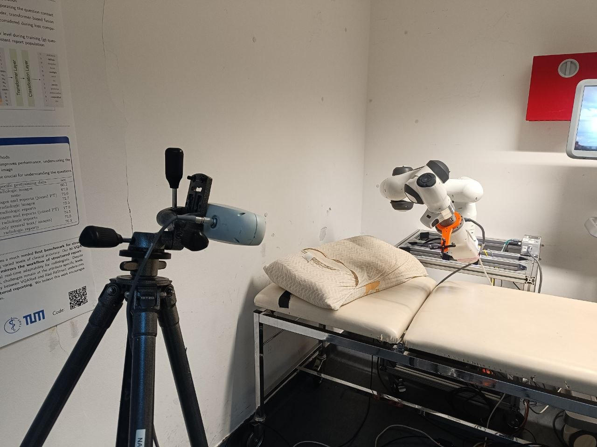
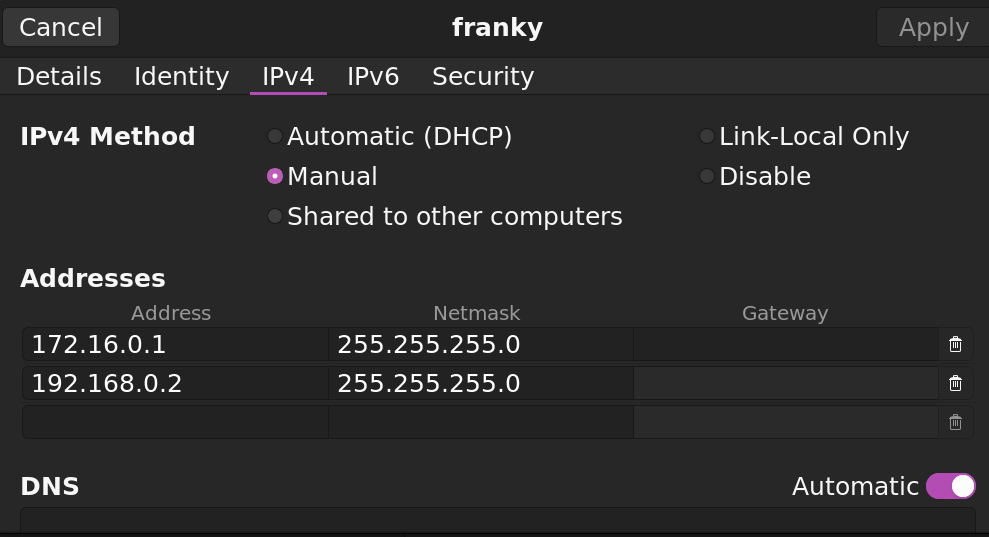

# ifl_franka_ndi_handeye

Repository for the hand-eye calibration of the Franka Emika Panda robot using the NDI Polaris Vega optical tracking system.

### Installation
- Install ROS2 Humble
- Download this repo with submodules:
```bash
git clone --recurse-submodules https://github.com/Hydran00/ifl_franka_ndi_handeye.git
```

- Build libfranka legacy
```bash
cd ifl_franka_ndi_handeye/franka_legacy_lib
cmake -S . -B build \
  -DCMAKE_BUILD_TYPE=Release \
  -DBUILD_TESTS=OFF

cmake --build build -j2
```
- Build franka the workspace
```bash
cd ifl_franka_ndi_handeye

colcon build --symlink-install \
  --cmake-args \
  -DCMAKE_BUILD_TYPE=Release \
  -DFranka_DIR:PATH=$HOME/franka_legacy_lib/libfranka/build \
  -DBUILD_TESTING=OFF
```

- Build calibration workspace
```bash
cd ifl_franka_ndi_handeye/calibration_ws
colcon build --symlink-install \
  --cmake-args \
  -DCMAKE_BUILD_TYPE=Release
```

### Setup
Mount the marker on the franka end effector as in the picture so that it is visible to the NDI system.

<p align="center">

</p>


Then run the following commands in separate terminals:

```bash
# Start the NDI driver
ros2 launch polaris_bringup vega.launch.py
```

- Connect via ethernet to the switch of the lab and set your IPs as in the image

<p align="center">

</p>

- Activate FCI from `172.16.0.2`
- Start franka driver
```
ros2 launch franka_bringup franka.launch.py   robot_ip:=172.16.0.2   robot_type:=fp3   load_gripper:=false   use_rviz:=false   use_fake_hardware:=false   namespace:="empty"
```

### Calibration
Launch `easy_handeye` calibration with the following command:
```bash
ros2 launch easy_handeye2 calibrate_holder_ifl.launch.py 
```
You should see the GUI with the possibility to acquire new poses and compute the hand-eye calibration.
Move the robot around and do ~30 acquisitions. 
After that, click on "Save" and to the calibration to a file.

You can then publish the computed transformation with the following command:
```bash
ros2 launch easy_handeye2 publish_franka_handeye.launch.py
```